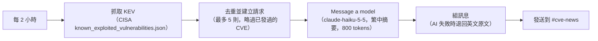
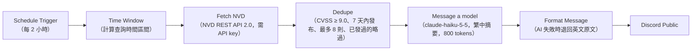

# Cyber Security 工作流

資安相關的 n8n workflow，用來抓取漏洞情報，經 Claude Haiku 5.5 整理成繁體中文摘要後送到 Discord。

---

## CISA KEV alert（2026/11/01）

每 2 小時抓取 CISA 的「已知被利用漏洞」（KEV）清單，把尚未處理過的新條目發到 Discord 的 #cve-news。

### 大致流程



<details>
<summary>文字版（備援）</summary>

```
每 2 小時
  → 抓取 KEV（CISA known_exploited_vulnerabilities.json）
  → 去重並建立請求（最多 5 則，略過已發過的 CVE）
  → Message a model（claude-haiku-5-5，繁中摘要，800 tokens）
  → 組訊息（AI 失敗時退回英文原文）
  → 發送到 #cve-news
```

</details>

### 注意事項

- 條目內容視為不可信資料：AI 輸出會移除連結、換行與 `@` 提及，避免 `@everyone` 之類的提及。
- `TEST_MODE`（去重程式碼上方）改成 `true` 可手動測試，會忽略去重、只處理最新 1 筆。測完要改回 `false`。

---

## NVD Critical Alerts（2026/11/04）

每 2 小時查詢 NVD 過去 24 小時內修改的 CVE，只通知 CVSS 基本分數 9.0 以上、且 7 天內發布的條目。

### 大致流程



<details>
<summary>文字版（備援）</summary>

```
Schedule Trigger（每 2 小時）
  → Time Window（計算查詢時間區間）
  → Fetch NVD（NVD REST API 2.0，需 API key）
  → Dedupe（CVSS ≥ 9.0、7 天內發布、最多 8 則、已發過的略過）
  → Message a model（claude-haiku-5-5，繁中摘要，800 tokens）
  → Format Message（AI 失敗時退回英文原文）
  → Discord Public
```

</details>

### 注意事項

- 查詢區間會記錄上次執行時間：第一次執行回看 3 小時，最多補 24 小時，並與上次區間重疊 15 分鐘以吸收 NVD 的延遲。
- 已通知的 CVE 紀錄保留 30 天。
- `TEST_MODE`（Time Window 上方）改成 `true` 可手動測試，會回看 24 小時、忽略去重、只送最新 1 筆。測完要改回 `false`。
- 每次最多處理 8 則，超過的會留到下一輪。

---

## 檔案

| 檔案 | Workflow |
|---|---|
| `CISA KEV alert.json` | CISA KEV alert |
| `NVD Critical Alerts.json` | NVD Critical Alerts |
