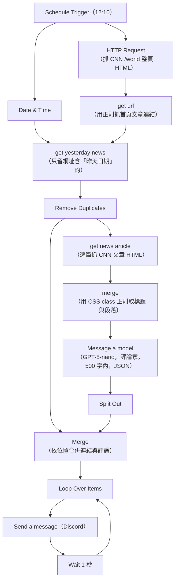
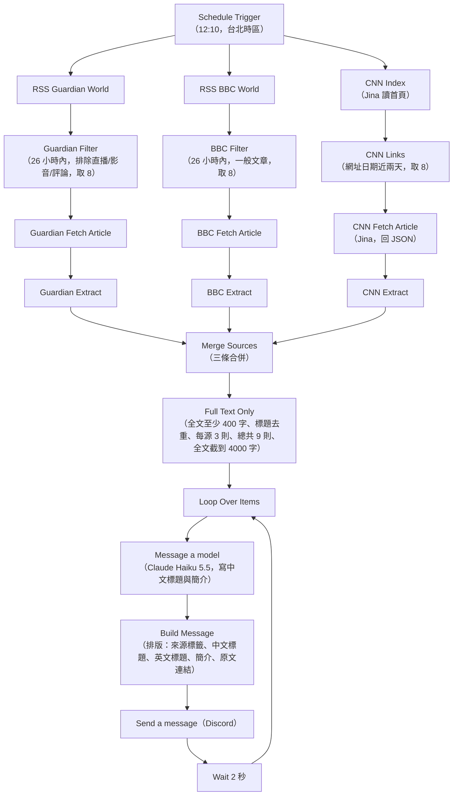
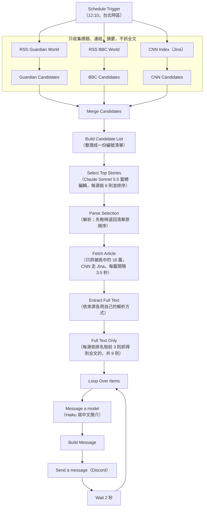

# International News 工作流

## 版本一：CNN_News.json(2026/03/05)

> 為第一代在 zeabur 運行的版本，於 2026/10/15 因資安事件廢除

### 大致流程



<details>
<summary>文字版（備援）</summary>

```
Schedule Trigger（12:10）
 ├─ Date & Time ───────────────────────────┐
 └─ HTTP Request（抓 CNN /world 整頁 HTML）  │
      ↓                                     │
    get url（用正則抓首頁文章連結）            │
      ↓  ←────────────────────────────────┘
    get yesterday news（只留網址含「昨天日期」的）
      ↓
    Remove Duplicates
      ├─→ get news article（逐篇抓 CNN 文章 HTML）
      │      ↓
      │    merge（用 CSS class 正則取標題與段落）
      │      ↓
      │    Message a model（GPT-5-nano，評論家，500 字內，JSON）
      │      ↓
      │    Split Out ──────────────┐
      └────────────────────────────┤
                                   ↓
                      Merge（依位置合併連結與評論）
                                   ↓
                      Loop Over Items → Send a message（Discord）→ Wait 1 秒 → 回到 Loop
```

</details>

---

## 版本二：international_news_v2.json(2026/10/17)
#### 未正式上線使用

移植至 GCP，重點差異:從單一 CNN news 變更為多來源

1. CNN News
2. The Guardian
3. BBC News

CNN 因原本 http request 在 GCP 會被擋所以改用 jina 來提取內文，其餘使用 RSS。

### 大致流程



<details>
<summary>文字版（備援）</summary>

```
Schedule Trigger（12:10，台北時區）
 ├─ Guardian：RSS Guardian World → Guardian Filter（26 小時內，排除直播/影音/評論，取 8）
 │              → Guardian Fetch Article → Guardian Extract
 ├─ BBC：     RSS BBC World → BBC Filter（26 小時內，一般文章，取 8）
 │              → BBC Fetch Article → BBC Extract
 └─ CNN：     CNN Index（Jina 讀首頁）→ CNN Links（網址日期近兩天，取 8）
                → CNN Fetch Article（Jina，回 JSON）→ CNN Extract
                    ↓（三條合併）
              Merge Sources
                    ↓
              Full Text Only（全文至少 400 字、標題去重、每源 3 則、總共 9 則、全文截到 4000 字）
                    ↓
              Loop Over Items
                    ↓
              Message a model（Claude Haiku 5.5，寫中文標題與簡介）
                    ↓
              Build Message（排版：來源標籤、中文標題、英文標題、簡介、原文連結）
                    ↓
              Send a message（Discord）→ Wait 2 秒 → 回到 Loop
```

</details>

---

## 版本三：international_news_v3.json

邏輯新增使用 Claude Sonnet 5.5 挑選最重要的新聞，不用在每一則都抓全文。

### 大致流程



<details>
<summary>文字版（備援）</summary>

```
Schedule Trigger（12:10，台北時區）
 ├─ RSS Guardian World → Guardian Candidates ─┐
 ├─ RSS BBC World      → BBC Candidates ──────┤（只收集標題、連結、摘要，不抓全文）
 └─ CNN Index（Jina）  → CNN Candidates ──────┘
                    ↓
              Merge Candidates
                    ↓
              Build Candidate List（整理成一份編號清單）
                    ↓
              Select Top Stories（Claude Sonnet 5.5 當總編輯，每源挑 6 則並排序）
                    ↓
              Parse Selection（解析；失敗時退回清單原順序）
                    ↓
              Fetch Article（只抓被挑中的 18 篇，CNN 走 Jina，每篇間隔 3.5 秒）
                    ↓
              Extract Full Text（依來源各用自己的解析方式）
                    ↓
              Full Text Only（每源依排名取前 3 則抓得到全文的，共 9 則）
                    ↓
              Loop Over Items → Message a model（Haiku 寫中文簡介）→ Build Message
                    ↓
              Send a message（Discord）→ Wait 2 秒 → 回到 Loop
```

</details>
